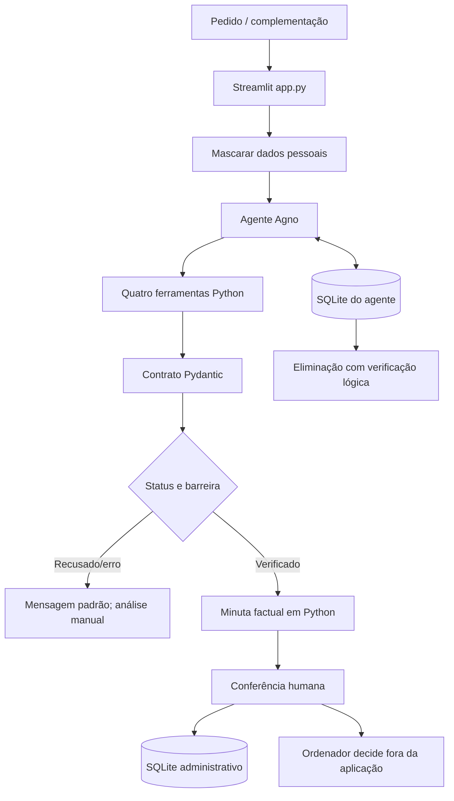

# Estrutura verificada do projeto — Desafio 06

> Inventário documental do repositório público `diegocbaleite/Desafio-06-Agentes-IA-Gestao-Diarias`, branch `main`, conferido em **21/11/2026** sobre a versão imediatamente anterior a esta atualização. Nome acadêmico do enunciado: **Desafio 01 — Instrução de Pedidos de Diárias** (Aulas 01 a 07). Este documento **não modifica nem move** os módulos Python.

## Visão geral

- Ponto de entrada: [`app.py`](../app.py) — seis páginas Streamlit, tratamento de pedidos, complementações, conferência, LGPD e auditoria.
- Orquestração: [`agente/agente_diarias.py`](../agente/agente_diarias.py) — **um agente Agno**, `construir_agente()` e `instruir()`.
- Fontes: `dados/` guarda dados sintéticos de cadastro, histórico, valores, normas e pedidos; `exemplos/` guarda gerador e cópias de referência.
- Persistência local: `bancos/agente_diarias.db` para trabalho do agente; `bancos/registro_conferencias.db` para registro administrativo — **não versionados**.
- Evidências: **22 PNGs anteriores + 29 PNGs da API real**, além de arquivos JSON, logs e relatórios; os números descrevem a árvore publicada, não testes executados agora.

## Diretórios e responsabilidade

| Local | Função | Observação |
|---|---|---|
| `agente/` | Prompt, contrato Pydantic, agente Agno e minuta factual | A minuta final é montada em Python após a barreira |
| `ferramentas/` | Quatro consultas: cadastro, histórico, cálculo e orçamento | Valores e antecedência calculados em código, não pelo modelo |
| `seguranca/` | Padrões de dados pessoais e validação independente da resposta | Trata entrada e resposta não confiáveis |
| `memoria/` | Banco protegido, histórico, conferências, busca e eliminação | Bancos do agente e administrativo separados |
| `avaliacao/` | Casos, comparação com gabarito, memória, falhas, tokens e desempenho | Gabarito externo não é passado ao agente |
| `simulador/` | Servidor local compatível com a API para testes e demonstração | Não é medição do modelo real |
| `testes/` | Testes de ferramenta, PII, barreira, memória, auditoria e regressões | Log mais recente: 131 aprovações em 21/11 |
| `dados/` e `exemplos/` | Acervo e gerador com dados **fictícios** | Não são cadastros reais de servidores |
| `docs/` | Auditoria, guia manual, apresentação e inventário | Documentação auxiliar |
| `resultados/` | Logs, medições, evidências e histórico | Distinguir API real de simulador |

## Arquivos e módulos verificados

### Ponto de entrada e configuração

- `app.py`
- `config.py`
- `.streamlit/config.toml`
- `.env.example`
- `.gitignore`
- `requirements.txt`
- `requirements.lock.txt`
- `pytest.ini`

### Agente Agno

- `agente/__init__.py`
- `agente/agente_diarias.py`
- `agente/instrucoes.py`
- `agente/modelos.py`
- `agente/minuta.py`

### Ferramentas e dados

- `ferramentas/__init__.py`
- `ferramentas/__main__.py`
- `ferramentas/acervo.py`
- `ferramentas/cadastro.py`
- `ferramentas/historico.py`
- `ferramentas/calculos.py`
- `ferramentas/orcamento.py`
- `dados/`
- `exemplos/`

### Persistência e segurança

- `memoria/__init__.py`
- `memoria/persistencia.py`
- `memoria/banco_protegido.py`
- `memoria/eliminacao.py`
- `memoria/verificacao.py`
- `seguranca/__init__.py`
- `seguranca/filtro_pii.py`
- `seguranca/barreiras.py`

### Medições e simulador

- `avaliacao/`
- `avaliacao/externo/gabarito.json`
- `simulador/`

### Testes

- `testes/`

### Documentos

- `README.md`
- `LEIA-ME.md`
- `desenho.md`
- `relatorio.md`
- `requisitos_rastreabilidade.md`
- `docs/`

### Resultados

- `resultados/`
- `resultados/evidencias/`
- `resultados/evidencias-manuais/`
- `resultados/evidencias-manuais/api-real-20261121/`
- `resultados/simulador/`
- `resultados/historico/`

## Organização das evidências

```text
resultados/
├── INDICE_EVIDENCIAS_API_REAL.md
├── comparacao_desempenho.json
├── execucao_casos_paralelas_desligadas.json
├── execucao_casos_paralelas_ligadas.json
├── falhas_provocadas.json
├── medicao_memoria.json
├── relatorio_medicoes.md
├── evidencias/
│   ├── pytest_correcao_20261121.txt
│   ├── correcao_auditoria_20261121.json
│   └── eliminacao_api_207418_20261121155444.json
├── evidencias-manuais/
│   ├── 22 capturas PNG anteriores
│   ├── RELATORIO_VALIDACAO_MANUAL.md
│   ├── manifesto.json
│   └── api-real-20261121/
│       └── 29 capturas PNG (01 a 29)
├── historico/
└── simulador/
```

O índice principal está em [`resultados/INDICE_EVIDENCIAS_API_REAL.md`](../resultados/INDICE_EVIDENCIAS_API_REAL.md) e os caminhos relativos das 29 capturas apontam para `resultados/evidencias-manuais/api-real-20261121/`. O índice **não é duplicado dentro da pasta** das imagens.

## Fluxo operacional identificado



## Segurança de versionamento

O [`.gitignore`](../.gitignore) ignora `.env`, `.venv/`, `bancos/`, extensões SQLite e `backup-testes-api/`. Somente `.env.example` deve estar publicado. O arquivo JSON de eliminação documenta dados fictícios, mas seu escopo de eliminação restringe-se ao banco de **trabalho**; backups e registros administrativos exigem tratamento separado.

## Verificação e limites

- Inspeção efetuada sobre a árvore e os arquivos de texto do GitHub; **nenhuma execução de Python nem modificação de banco** foi realizada nesta atualização.
- O log de [131 testes aprovados](../resultados/evidencias/pytest_correcao_20261121.txt) é evidência histórica do próprio projeto; os resultados de 19/11 são da API real **antes** das correções finais.
- A instalação limpa em outro computador, autenticação institucional e expurgo automático por prazo não foram demonstrados.
- Não altere caminhos de pacotes ou migre `app.py` sem executar novamente os testes, pois imports e caminhos de dados dependem da estrutura atual.
